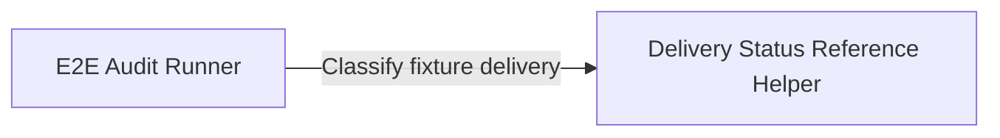

# E2E 0.4.3 — Implement isolated delivery classifier

> Card report · Complete scope

**Status:** Done · **Edition:** —

## Overview

- **Status:** Done

**Description**

Create delivery\_status.py in the isolated fixture workspace after native execution admission. Implement fr\_e2e\_classify, tr\_e2e\_isolation and br\_8bb896ec, covering ac\_e2e\_states and ac\_e2e\_isolation. Validate enums and bool before applying exact precedence. No imports or side effects. Commit the actual implementation, record target execution and bind proof to the five obligations. Verification is performed by the separate Test Card; progress text never counts as proof.

**Priority**

none

**Position**

1

**Created At**

2026-11-04T13:32:06+00:00

**Updated At**

2026-11-04T14:01:43+00:00

**Skip Task Requirement Link Gate**

No

#### Labels

- e2e-043

#### Conclusions

##### E2E controlled negative review: helper covers 18 valid states and enum rejection but is intentionally incomplete. Authenticated classifier run failed six non-boolean cases. Subm…

**Completeness**

70

**Completeness Justification**

Strict boolean validation required by FR and AC is missing; implementation declared partial for four of five obligations.

**Created At**

2026-11-04T13:54:10.086993+00:00

**Drift**

0

**Drift Justification**

The fixture remains within its isolated planned scope; incompleteness is explicit, not an unplanned scope change.

**Source**

move\_to\_validation

###### Delivery Manifest

###### Delivery Manifest 1

**Card Version**

3

**Delivery Revision**

2

**Impact Sha256**

74234e98af…

**Scope Sha256**

e32ca3c947…

**Sha256**

582f1815e0…

**Spec Edition**

1

###### Records

###### Record 1

**Kind**

implementation

**Sha256**

f768ab67a7…

##### Corrected the controlled strict-boolean defect in fixture commit 8cf8509. The pure helper now implements every specified state and input error. Both authenticated required scena…

**Completeness**

100

**Completeness Justification**

All five assigned obligations have a complete current implementation binding; the exhaustive classifier and isolation checks pass.

**Created At**

2026-11-04T14:01:10.058661+00:00

**Drift**

0

**Drift Justification**

No production files or external dependencies were changed; implementation stays in the approved fixture workspace.

**Source**

move\_to\_validation

###### Delivery Manifest

###### Delivery Manifest 1

**Card Version**

3

**Delivery Revision**

3

**Impact Sha256**

74234e98af…

**Scope Sha256**

e32ca3c947…

**Sha256**

974c0979fa…

**Spec Edition**

1

###### Records

###### Record 1

**Kind**

implementation

**Sha256**

9df4b07833…

## Comments

### Comments

#### Comment 1

**Content**

## Spec Q&A Context  \*\*Q:\*\* For this E2E fixture, which execution approach preserves meaningful delivery proof while keeping the production application unchanged? \*\*A:\*\* E2E fixture selection under the authorized audit: use real isolated implementation and execution evidence. Synthetic status values must never count as proof. 

**Comment Type**

text

**Allow Free Text**

No

**Created At**

2026-11-04T13:32:33+00:00

**Updated At**

2026-11-04T13:32:33+00:00

## Mockups

E2E delivery review reference · panel

Reference for the UI audit of the existing Delivery screen. The helper is a test fixture; this mockup documents the expected human-facing review layout, not a new production screen.

_A passive inline visual preview is available in the HTML export._

## Architecture

E2E reference helper and verification boundary

The external audit runner executes a small isolated Python reference helper. The helper classifies fixture delivery inputs and never reads or writes Pulse storage. Test results are observed by the authenticated agent and submitted through the native Pulse evidence contracts. The existing application UI is verified separately; this design is a test fixture, not a new production service.

#### E2E Audit Runner — Boundaries

- External agent workspace
- No direct Pulse storage access

#### Delivery Status Reference Helper — Boundaries

- Pure function within the fixture process
- No network, storage or Pulse state mutation

#### Fixture execution boundary

## Task validation

### Validations

#### Reject this controlled E2E fixture revision. Add strict bool input validation before status precedence and rerun the exact required scenarios against the corrected committed rev…

- **Recommendation:** Reject

| Dimension | Score | Threshold | Rationale |
|---|---:|---|---|
| Confidence | 99 | higher is better | Observed committed source and authenticated classifier run c331ff3b159317c227b32ff9448a4c9c agree: six non-boolean inputs fail the required TypeError assertion. |

**Created At**

2026-11-04T13:54:49.817703+00:00

**Reviewer**

Codex

**Completeness**

70

**Completeness Justification**

All 18 valid states and invalid enums are covered, but the strict boolean guard is absent and four obligations are explicitly partial.

**Drift**

0

**Drift Justification**

No production source or unplanned dependency was modified.

**Validation Outcome**

failed

**Completion Outcome**

rejected

##### Threshold Failures

- Completeness 70 \< min 80

#### Approve the corrected fixture after the controlled rejection/rework cycle. The previously missing bool guard is present before all status branches, and prior failure history rem…

- **Recommendation:** Approve

| Dimension | Score | Threshold | Rationale |
|---|---:|---|---|
| Confidence | 98 | higher is better | Reviewed committed implementation 8cf8509 and exact signed classifier/isolation runs. Complete source, target and association provenance is current; both scenarios pass and the Test Card is Done. |

**Created At**

2026-11-04T14:01:43.625654+00:00

**Reviewer**

Codex

**Completeness**

100

**Completeness Justification**

All five assigned obligations are implemented. All 18 valid cases, invalid enums, strict booleans and AST isolation are covered by real passing tests.

**Drift**

0

**Drift Justification**

Change is limited to the approved isolated fixture and standard-library tests; no production behavior was modified.

**Validation Outcome**

success

**Completion Outcome**

completed

## Completion rejections

### Rejection Records

#### Reject this controlled E2E fixture revision. Add strict bool input validation before status precedence and rerun the exact required scenarios against the corrected committed rev…

**Created At**

2026-11-04T13:54:49.826469+00:00

**Cause Type**

Task validation

##### Reasons

- Completeness below
- Reject recommendation

## Test scenarios

### Test Scenario IDs

- ts\_4e90347d
- ts\_22468e79

## Activity

### Activity Logs

#### Activity Log 1

**Action**

card\_created

**Actor Type**

agent

**Actor Name**

Codex

**Created At**

2026-11-04T13:32:06+00:00

##### Details

###### E2E 0.4.3 — Implement isolated delivery classifier

- **Status:** Not Started

**Priority**

none

###### Traceability

###### Traceability 1

**Idempotent**

No

###### Changed

###### Changed 1

**Target Type**

scenario

###### Changed 2

**Target Type**

scenario

###### Changed 3

**Target Type**

fr

###### Changed 4

**Target Type**

rule

###### Requested

###### Requested 1

**Target Type**

scenario

###### Requested 2

**Target Type**

scenario

###### Requested 3

**Target Type**

fr

###### Requested 4

**Target Type**

rule

#### Activity Log 2

**Action**

card\_updated

**Actor Type**

user

**Actor Name**

Codex

**Created At**

2026-11-04T13:32:32+00:00

##### Details

###### Detail 1

###### Changes

###### Change 1

**Field**

screen\_mockups

###### New

###### E2E delivery review reference

**Description**

Reference for the UI audit of the existing Delivery screen. The helper is a test fixture; this mockup documents the expected human-facing review layout, not a new production screen.

**HTML Content**

\<main class="mx-auto max-w-4xl bg-slate-950 text-slate-100 p-8 space-y-6"\>\<header\>\
E2E audit reference\</p\>\<h1 class="text-2xl font-semibold"\>Delivery\</h1\>\</header\>\<section class="rounded-xl border border-amber-400 p-5"\>\<h2 class="text-lg font-semibold"\>◷ Awaiting verification\</h2\>\<p\>Implementation is complete. The required checks are still pending.\</p\>\</section\>\
\
Implementation \<strong\>100%\</strong\>\</p\>\
Verification \<strong\>0%\</strong\>\</p\>\</div\>\<table class="w-full text-left"\>\<thead\>\<tr\>\<th\>Requirement / Objective\</th\>\<th\>Implementation\</th\>\<th\>Verification\</th\>\</tr\>\</thead\>\<tbody\>\<tr\>\<td\>Classify fixture delivery\</td\>\<td\>✓ Implemented\</td\>\<td\>◷ Pending\</td\>\</tr\>\</tbody\>\</table\>\
\<button class="border rounded-lg px-4 py-2"\>Show details\</button\>\<button class="border rounded-lg px-4 py-2"\>Change task requirements\</button\>\</div\>\<section class="border-t pt-4"\>\<h2 class="font-semibold"\>Pending work and verification\</h2\>\<table class="w-full text-left mt-3"\>\<thead\>\<tr\>\<th\>Requirement / Objective\</th\>\<th\>Affected stage\</th\>\<th\>What needs attention\</th\>\<th\>Next step\</th\>\</tr\>\</thead\>\<tbody\>\<tr\>\<td\>Classify fixture delivery\</td\>\<td\>Verification\</td\>\<td\>The expected state cases have not been executed.\</td\>\<td\>Run the required scenario against the current implementation.\</td\>\</tr\>\</tbody\>\</table\>\
Evidence and technical details are optional. Human updates generate an audit receipt automatically.\</p\>\</section\>\</main\>

**Order**

0

**Screen Type**

panel

###### Screen Mockups

###### E2E delivery review reference

**Description**

Reference for the UI audit of the existing Delivery screen. The helper is a test fixture; this mockup documents the expected human-facing review layout, not a new production screen.

**HTML Content**

\<main class="mx-auto max-w-4xl bg-slate-950 text-slate-100 p-8 space-y-6"\>\<header\>\
E2E audit reference\</p\>\<h1 class="text-2xl font-semibold"\>Delivery\</h1\>\</header\>\<section class="rounded-xl border border-amber-400 p-5"\>\<h2 class="text-lg font-semibold"\>◷ Awaiting verification\</h2\>\<p\>Implementation is complete. The required checks are still pending.\</p\>\</section\>\
\
Implementation \<strong\>100%\</strong\>\</p\>\
Verification \<strong\>0%\</strong\>\</p\>\</div\>\<table class="w-full text-left"\>\<thead\>\<tr\>\<th\>Requirement / Objective\</th\>\<th\>Implementation\</th\>\<th\>Verification\</th\>\</tr\>\</thead\>\<tbody\>\<tr\>\<td\>Classify fixture delivery\</td\>\<td\>✓ Implemented\</td\>\<td\>◷ Pending\</td\>\</tr\>\</tbody\>\</table\>\
\<button class="border rounded-lg px-4 py-2"\>Show details\</button\>\<button class="border rounded-lg px-4 py-2"\>Change task requirements\</button\>\</div\>\<section class="border-t pt-4"\>\<h2 class="font-semibold"\>Pending work and verification\</h2\>\<table class="w-full text-left mt-3"\>\<thead\>\<tr\>\<th\>Requirement / Objective\</th\>\<th\>Affected stage\</th\>\<th\>What needs attention\</th\>\<th\>Next step\</th\>\</tr\>\</thead\>\<tbody\>\<tr\>\<td\>Classify fixture delivery\</td\>\<td\>Verification\</td\>\<td\>The expected state cases have not been executed.\</td\>\<td\>Run the required scenario against the current implementation.\</td\>\</tr\>\</tbody\>\</table\>\
Evidence and technical details are optional. Human updates generate an audit receipt automatically.\</p\>\</section\>\</main\>

**Order**

0

**Screen Type**

panel

#### Activity Log 3

**Action**

critical\_context\_guard\_decision

**Actor Type**

user

**Actor Name**

Codex

**Created At**

2026-11-04T13:32:32+00:00

##### Details

###### Detail 1

- **Outcome:** Allow

**Context Profile**

full

**Context Resolved At**

2026-11-04T13:32:32.738990+00:00

**Critical Action**

card.update

**Entity Type**

card

**Metric Name**

critical\_context\_guard\_decision\_total

**Reason**

full\_context\_resolved

**Surface**

service

#### Activity Log 4

**Action**

code\_investig\_requested

**Actor Type**

agent

**Actor Name**

e7090eed

**Created At**

2026-11-04T13:38:10.473020+00:00

##### Details

###### Detail 1

**Event Type**

code\_investig.requested

**Read Model Projection**

query\_time

###### Payload

###### Payload 1

**Expected Head Generation**

2

**Request Payload Sha256**

24865f5b0f…

**Required Capability Count**

10

#### Activity Log 5

**Action**

code\_investig\_receipt\_submitted

**Actor Type**

agent

**Actor Name**

e7090eed

**Created At**

2026-11-04T13:38:32.789354+00:00

##### Details

###### Detail 1

**Event Type**

code\_investig.receipt\_submitte

**Read Model Projection**

query\_time

###### Payload

###### Payload 1

**Acceptance Status**

accepted

**Contextual Outcome**

no\_relevant\_existing\_implementation

**Delivery Context**

greenfield

**Generation**

3

**Observation Sha256**

05a5e806d1…

**Omission Count**

0

**Payload Sha256**

905a43fcd3…

**Trust Level**

single\_attestat

#### Activity Log 6

**Action**

implementation\_target\_created

**Actor Type**

agent

**Actor Name**

e7090eed

**Created At**

2026-11-04T13:38:33.562947+00:00

##### Details

###### Detail 1

**Event Type**

implementation\_target.created

**Read Model Projection**

query\_time

###### Payload

###### Payload 1

- **Lifecycle Status:** Active

**Payload Sha256**

cc4cd12d1c…

**Revision**

1

#### Activity Log 7

**Action**

code\_investig\_requested

**Actor Type**

agent

**Actor Name**

e7090eed

**Created At**

2026-11-04T13:39:12.735661+00:00

##### Details

###### Detail 1

**Event Type**

code\_investig.requested

**Read Model Projection**

query\_time

###### Payload

###### Payload 1

**Expected Head Generation**

3

**Request Payload Sha256**

a923a92759…

**Required Capability Count**

10

#### Activity Log 8

**Action**

code\_investig\_receipt\_submitted

**Actor Type**

agent

**Actor Name**

e7090eed

**Created At**

2026-11-04T13:39:39.007902+00:00

##### Details

###### Detail 1

**Event Type**

code\_investig.receipt\_submitte

**Read Model Projection**

query\_time

###### Payload

###### Payload 1

**Acceptance Status**

accepted

**Contextual Outcome**

no\_relevant\_existing\_implementation

**Delivery Context**

greenfield

**Generation**

4

**Observation Sha256**

b8428bdc2d…

**Omission Count**

0

**Payload Sha256**

6094181446…

**Trust Level**

single\_attestat

#### Activity Log 9

**Action**

implementation\_target\_resolution\_submitted

**Actor Type**

agent

**Actor Name**

e7090eed

**Created At**

2026-11-04T13:40:03.175500+00:00

##### Details

###### Detail 1

**Event Type**

implementation\_target.resolution\_submitte

**Read Model Projection**

query\_time

###### Payload

###### Payload 1

**Candidate Count**

0

**Payload Sha256**

f08c32a869…

**Receipt Generation**

4

**Resolution State**

missing

**Target Revision**

1

#### Activity Log 10

**Action**

critical\_context\_guard\_decision

**Actor Type**

user

**Actor Name**

Codex

**Created At**

2026-11-04T13:40:05+00:00

##### Details

###### Detail 1

- **Outcome:** Allow

**Context Profile**

full

**Context Resolved At**

2026-11-04T13:40:05.225511+00:00

**Critical Action**

card.start\_implemen

**Entity Type**

card

**Metric Name**

critical\_context\_guard\_decision\_total

**Reason**

full\_context\_resolved

**Surface**

service

#### Activity Log 11

**Action**

card\_moved

**Actor Type**

user

**Actor Name**

Codex

**Created At**

2026-11-04T13:40:05+00:00

##### Details

###### Detail 1

**From Position**

1

**From Status**

not\_started

**To Position**

2

**To Status**

in\_progress

#### Activity Log 12

**Action**

task.human\_submissi\_accepted

**Actor Type**

user

**Actor Name**

local-user

**Created At**

2026-11-04T13:43:37+00:00

##### Details

###### Detail 1

**Action**

progress

**Content Sha256**

c39bb84698…

#### Activity Log 13

**Action**

code\_investig\_requested

**Actor Type**

agent

**Actor Name**

e7090eed

**Created At**

2026-11-04T13:43:50.954088+00:00

##### Details

###### Detail 1

**Event Type**

code\_investig.requested

**Read Model Projection**

query\_time

###### Payload

###### Payload 1

**Expected Head Generation**

6

**Request Payload Sha256**

97e918f70b…

**Required Capability Count**

10

#### Activity Log 14

**Action**

code\_investig\_receipt\_submitted

**Actor Type**

agent

**Actor Name**

e7090eed

**Created At**

2026-11-04T13:44:23.476911+00:00

##### Details

###### Detail 1

**Event Type**

code\_investig.receipt\_submitte

**Read Model Projection**

query\_time

###### Payload

###### Payload 1

**Acceptance Status**

accepted

**Contextual Outcome**

evidence\_applicab

**Delivery Context**

greenfield

**Generation**

7

**Observation Sha256**

76b6802c62…

**Omission Count**

0

**Payload Sha256**

88806c689e…

**Trust Level**

single\_attestat

#### Activity Log 15

**Action**

implementation\_target\_execution\_receipt\_submitted

**Actor Type**

agent

**Actor Name**

e7090eed

**Created At**

2026-11-04T13:44:23.716851+00:00

##### Details

###### Detail 1

**Event Type**

implementation\_target.execution\_receipt\_submitted

**Read Model Projection**

query\_time

###### Payload

###### Payload 1

**Disposition**

created

**Payload Sha256**

756625aa4e…

**Target Revision**

1

#### Activity Log 16

**Action**

implementation\_target\_resolution\_submitted

**Actor Type**

agent

**Actor Name**

e7090eed

**Created At**

2026-11-04T13:49:36.405406+00:00

##### Details

###### Detail 1

**Event Type**

implementation\_target.resolution\_submitte

**Read Model Projection**

query\_time

###### Payload

###### Payload 1

**Candidate Count**

0

**Payload Sha256**

79e4f7bea5…

**Receipt Generation**

7

**Resolution State**

resolved

**Target Revision**

1

#### Activity Log 17

**Action**

task.requirement\_decision\_applied

**Actor Type**

user

**Actor Name**

local-user

**Created At**

2026-11-04T13:52:28+00:00

##### Details

###### Detail 1

**Decision**

optional

**Spec Edition**

1

#### Activity Log 18

**Action**

task.requirement\_decision\_applied

**Actor Type**

user

**Actor Name**

local-user

**Created At**

2026-11-04T13:54:07+00:00

##### Details

###### Detail 1

**Decision**

waived

**Spec Edition**

1

#### Activity Log 19

**Action**

task.requirement\_decision\_applied

**Actor Type**

user

**Actor Name**

local-user

**Created At**

2026-11-04T13:54:08+00:00

##### Details

###### Detail 1

**Decision**

required

**Spec Edition**

1

#### Activity Log 20

**Action**

card\_moved

**Actor Type**

user

**Actor Name**

Codex

**Created At**

2026-11-04T13:54:10+00:00

##### Details

###### Detail 1

**From Position**

2

**From Status**

in\_progress

**To Position**

0

**To Status**

validation

#### Activity Log 21

**Action**

critical\_context\_guard\_decision

**Actor Type**

user

**Actor Name**

Codex

**Created At**

2026-11-04T13:54:10+00:00

##### Details

###### Detail 1

- **Outcome:** Allow

**Context Profile**

full

**Context Resolved At**

2026-11-04T13:54:10.082788+00:00

**Critical Action**

card.move\_status

**Entity Type**

card

**Metric Name**

critical\_context\_guard\_decision\_total

**Reason**

full\_context\_resolved

**Surface**

service

#### Activity Log 22

**Action**

critical\_context\_guard\_decision

**Actor Type**

agent

**Actor Name**

Codex

**Created At**

2026-11-04T13:54:49+00:00

##### Details

###### Detail 1

- **Outcome:** Allow

**Context Profile**

full

**Context Resolved At**

2026-11-04T13:54:49.813104+00:00

**Critical Action**

card.submit\_validati

**Entity Type**

card

**Metric Name**

critical\_context\_guard\_decision\_total

**Reason**

full\_context\_resolved

**Surface**

service

#### Activity Log 23

**Action**

validation\_submitte

**Actor Type**

agent

**Actor Name**

Codex

**Created At**

2026-11-04T13:54:49+00:00

##### Details

###### Detail 1

- **Outcome:** Failed
- **Recommendation:** Reject

| Dimension | Score | Threshold | Rationale |
|---|---:|---|---|
| Confidence | 99 | higher is better | — |

**Card Title**

E2E 0.4.3 — Implement isolated delivery classifier

**Completion Outcome**

rejected

**Estimated Completeness**

70

**Estimated Drift**

0

**Validation Outcome**

failed

###### Rejection Cause

###### Reject this controlled E2E fixture revision. Add strict bool input validation before status precedence and rerun the exact required scenarios against the corrected committed rev…

**Code**

task\_validati\_failed

**Kind**

task\_validati

###### Threshold Violations

- completeness 70 \< min 80

#### Activity Log 24

**Action**

critical\_context\_guard\_decision

**Actor Type**

user

**Actor Name**

Codex

**Created At**

2026-11-04T13:55:29+00:00

##### Details

###### Detail 1

- **Outcome:** Allow

**Context Profile**

full

**Context Resolved At**

2026-11-04T13:55:29.269307+00:00

**Critical Action**

card.start\_implemen

**Entity Type**

card

**Metric Name**

critical\_context\_guard\_decision\_total

**Reason**

full\_context\_resolved

**Surface**

service

#### Activity Log 25

**Action**

card\_moved

**Actor Type**

user

**Actor Name**

Codex

**Created At**

2026-11-04T13:55:29+00:00

##### Details

###### Detail 1

**From Position**

0

**From Status**

rejected

**To Position**

3

**To Status**

in\_progress

#### Activity Log 26

**Action**

code\_investig\_requested

**Actor Type**

agent

**Actor Name**

e7090eed

**Created At**

2026-11-04T13:55:52.255635+00:00

##### Details

###### Detail 1

**Event Type**

code\_investig.requested

**Read Model Projection**

query\_time

###### Payload

###### Payload 1

**Expected Head Generation**

7

**Request Payload Sha256**

67ad808207…

**Required Capability Count**

10

#### Activity Log 27

**Action**

code\_investig\_receipt\_submitted

**Actor Type**

agent

**Actor Name**

e7090eed

**Created At**

2026-11-04T13:56:17.269989+00:00

##### Details

###### Detail 1

**Event Type**

code\_investig.receipt\_submitte

**Read Model Projection**

query\_time

###### Payload

###### Payload 1

**Acceptance Status**

accepted

**Contextual Outcome**

evidence\_applicab

**Delivery Context**

greenfield

**Generation**

8

**Observation Sha256**

484196d194…

**Omission Count**

0

**Payload Sha256**

d32b1400af…

**Trust Level**

single\_attestat

#### Activity Log 28

**Action**

implementation\_target\_resolution\_submitted

**Actor Type**

agent

**Actor Name**

e7090eed

**Created At**

2026-11-04T13:56:39.504690+00:00

##### Details

###### Detail 1

**Event Type**

implementation\_target.resolution\_submitte

**Read Model Projection**

query\_time

###### Payload

###### Payload 1

**Candidate Count**

0

**Payload Sha256**

d16be21e1a…

**Receipt Generation**

8

**Resolution State**

resolved

**Target Revision**

1

#### Activity Log 29

**Action**

implementation\_target\_execution\_receipt\_submitted

**Actor Type**

agent

**Actor Name**

e7090eed

**Created At**

2026-11-04T13:56:40.005560+00:00

##### Details

###### Detail 1

**Event Type**

implementation\_target.execution\_receipt\_submitted

**Read Model Projection**

query\_time

###### Payload

###### Payload 1

**Disposition**

touched

**Payload Sha256**

e29718a010…

**Target Revision**

1

#### Activity Log 30

**Action**

critical\_context\_guard\_decision

**Actor Type**

user

**Actor Name**

Codex

**Created At**

2026-11-04T14:01:10+00:00

##### Details

###### Detail 1

- **Outcome:** Allow

**Context Profile**

full

**Context Resolved At**

2026-11-04T14:01:10.037486+00:00

**Critical Action**

card.move\_status

**Entity Type**

card

**Metric Name**

critical\_context\_guard\_decision\_total

**Reason**

full\_context\_resolved

**Surface**

service

#### Activity Log 31

**Action**

card\_moved

**Actor Type**

user

**Actor Name**

Codex

**Created At**

2026-11-04T14:01:10+00:00

##### Details

###### Detail 1

**From Position**

2

**From Status**

in\_progress

**To Position**

0

**To Status**

validation

#### Activity Log 32

**Action**

critical\_context\_guard\_decision

**Actor Type**

agent

**Actor Name**

Codex

**Created At**

2026-11-04T14:01:40+00:00

##### Details

###### Detail 1

- **Outcome:** Allow

**Context Profile**

full

**Context Resolved At**

2026-11-04T14:01:40.892876+00:00

**Critical Action**

card.submit\_validati

**Entity Type**

card

**Metric Name**

critical\_context\_guard\_decision\_total

**Reason**

full\_context\_resolved

**Surface**

service

#### Activity Log 33

**Action**

validation\_submitte

**Actor Type**

agent

**Actor Name**

Codex

**Created At**

2026-11-04T14:01:43+00:00

##### Details

###### Detail 1

- **Outcome:** Success
- **Recommendation:** Approve

| Dimension | Score | Threshold | Rationale |
|---|---:|---|---|
| Confidence | 98 | higher is better | — |

**Card Title**

E2E 0.4.3 — Implement isolated delivery classifier

**Completion Outcome**

completed

**Estimated Completeness**

100

**Estimated Drift**

0

**Validation Outcome**

success

## Implementation targets

### Implementation targets

#### Implementation target 1

- **Lifecycle Status:** Active

**Selector Kind**

new\_file

**Relative Path Hint**

delivery\_status.py

**Language**

python

**Qualified Symbol**

classify\_delivery

**Role**

create

**Intent**

Create the pure delivery classifier with input validation, exact status precedence and no imports.

**Required**

Yes

**Revision**

1

**Created At**

2026-11-04T13:38:33.503876+00:00

**Updated At**

2026-11-04T13:56:39.411274+00:00

### Implementation Target Resolutions

#### Implementation Target Resolution 1

- **State:** Missing

**Receipt Generation**

4

**Target Revision**

1

**Declared Revision**

bc08e53946…

**Declared Dirty**

No

**Reason Code**

missing\_expected

**Candidate Count**

0

**Declared Tool Version**

3.13.1

**Submitted By**

e7090eed

**Agent Observed At**

2026-11-04T13:39:15.595231+00:00

**Received At**

2026-11-04T13:40:02.956596+00:00

**Payload Sha256**

f08c32a869…

#### Implementation Target Resolution 2

- **State:** Resolved

| Dimension | Score | Threshold | Rationale |
|---|---:|---|---|
| Confidence | 1.0 | higher is better | — |

**Receipt Generation**

7

**Target Revision**

1

**Declared Revision**

44e22f2f95…

**Declared Dirty**

No

**Resolved Relative Path**

delivery\_status.py

**Resolved Language**

python

**Resolved Symbol Kind**

function

**Resolved Qualified Symbol**

classify\_delivery

**Resolved Line Start**

4

**Resolved Line End**

18

**Declared File Blob Sha256**

a8001fc571…

**Candidate Count**

0

**Declared Tool Version**

1

**Submitted By**

e7090eed

**Agent Observed At**

2026-11-04T13:43:53.230758+00:00

**Received At**

2026-11-04T13:49:36.374074+00:00

**Payload Sha256**

79e4f7bea5…

#### Implementation Target Resolution 3

- **State:** Resolved

| Dimension | Score | Threshold | Rationale |
|---|---:|---|---|
| Confidence | 1.0 | higher is better | — |

**Receipt Generation**

8

**Target Revision**

1

**Declared Revision**

8cf8509cd2…

**Declared Dirty**

No

**Resolved Relative Path**

delivery\_status.py

**Resolved Language**

python

**Resolved Symbol Kind**

function

**Resolved Qualified Symbol**

classify\_delivery

**Resolved Line Start**

4

**Resolved Line End**

19

**Declared File Blob Sha256**

fa9f0653ca…

**Candidate Count**

0

**Declared Tool Version**

3.13.1

**Submitted By**

e7090eed

**Agent Observed At**

2026-11-04T13:55:39.367367+00:00

**Received At**

2026-11-04T13:56:39.411274+00:00

**Payload Sha256**

d16be21e1a…

### Implementation Target Execution Records

#### Implementation Target Execution Record 1

**Target Revision**

1

**Disposition**

created

**Result Declared Revision**

44e22f2f95…

**Actual Relative Path**

delivery\_status.py

**Actual Qualified Symbol**

classify\_delivery

**Justification**

Committed the first fixture implementation. Valid status and enum paths exist; the intentionally controlled missing bool guard is confirmed by six failing subcases and remains incomplete.

**Submitted By**

e7090eed

**Received At**

2026-11-04T13:44:23.673402+00:00

**Payload Sha256**

756625aa4e…

#### Implementation Target Execution Record 2

**Target Revision**

1

**Disposition**

touched

**Result Declared Revision**

8cf8509cd2…

**Actual Relative Path**

delivery\_status.py

**Actual Qualified Symbol**

classify\_delivery

**Justification**

Corrected committed revision 8cf8509 validates the strict bool type before applying exact status precedence. Exhaustive 18 combinations, invalid enums, six invalid-type cases and AST isolation all pass locally. All assigned implementation obligations are now complete; authenticated Test Card verification follows separately.

**Submitted By**

e7090eed

**Received At**

2026-11-04T13:56:39.960513+00:00

**Payload Sha256**

e29718a010…

### Implementation Target Spec Links

#### Implementation Target Spec Link 1

**Entity Type**

business\_rule

**Created At**

2026-11-04T13:38:33.542327+00:00

#### Implementation Target Spec Link 2

**Entity Type**

acceptance\_criterio

**Created At**

2026-11-04T13:38:33.542327+00:00

#### Implementation Target Spec Link 3

**Entity Type**

functional\_requirem

**Created At**

2026-11-04T13:38:33.542327+00:00

#### Implementation Target Spec Link 4

**Entity Type**

acceptance\_criterio

**Created At**

2026-11-04T13:38:33.542327+00:00

#### Implementation Target Spec Link 5

**Entity Type**

technical\_requirem

**Created At**

2026-11-04T13:38:33.542327+00:00

## Target Overlaps

### Implementation targets

#### Implementation target 1

## Report completeness

Availability of report sections

- **Complete for viewer:** Yes
- **Source complete:** Yes
- **Generated at:** 2026-11-04T14:12:35.229697+00:00

| Section | Availability |
|---|---|
| Overview | Included |
| Relationships | Empty |
| Q&A | Empty |
| Comments | Included |
| Attachments | Empty |
| Knowledge | Empty |
| Mockups | Included |
| Architecture | Included |
| Task validation | Included |
| Completion rejections | Included |
| Test scenarios | Included |
| Activity | Included |
| Policy compliance | Empty |
| Policy waivers | Empty |
| Code investigations | Empty |
| Code evidence | Empty |
| Code traceability waivers | Empty |
| Implementation targets | Included |
| Target Overlaps | Included |
| Resource decisions | Empty |

